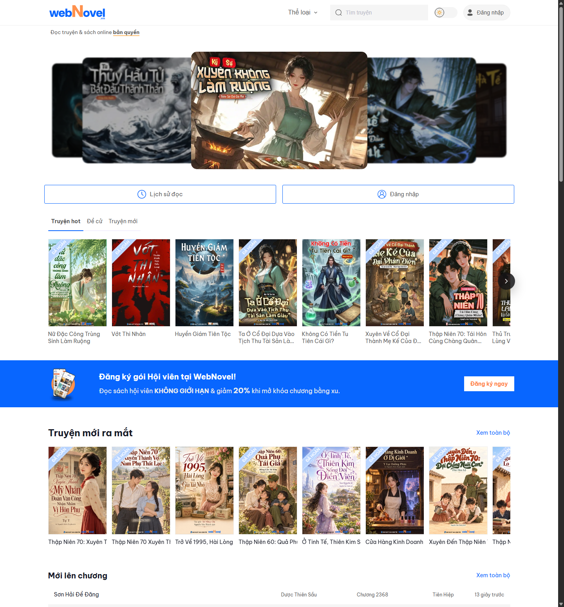
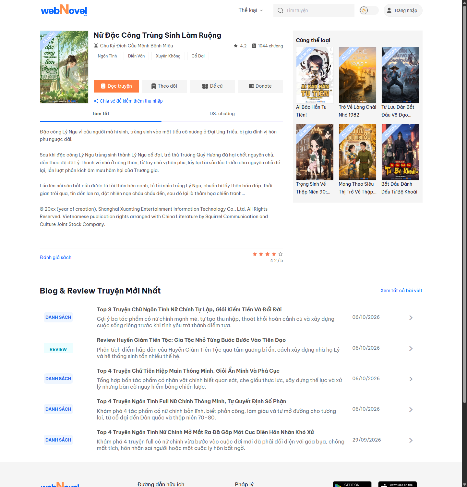
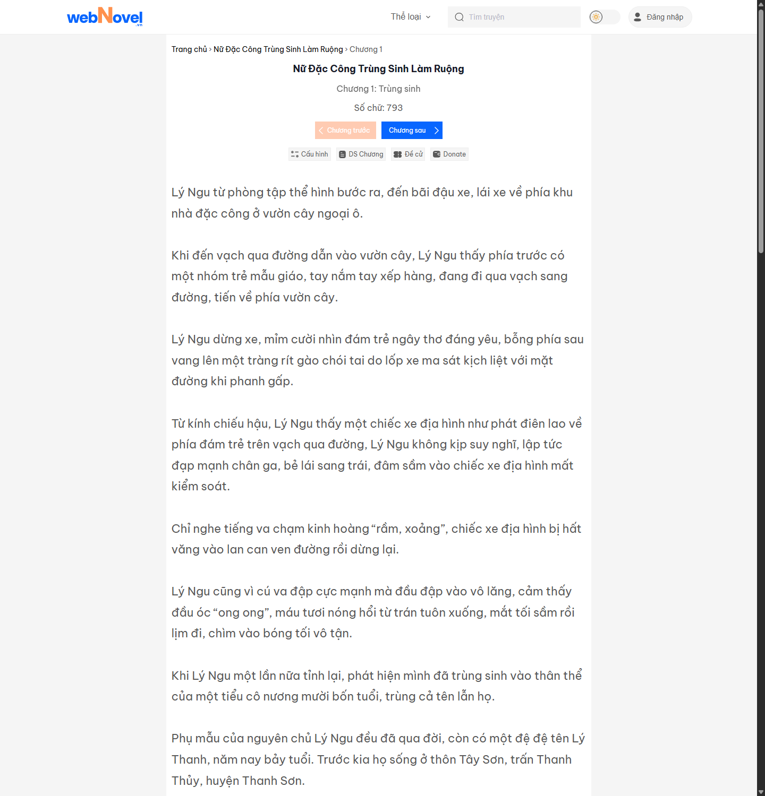

# Reverse engineering giao diện đọc truyện webnovel.vn

Ngày khảo sát: 09/10/2026. Phạm vi: giao diện công khai, luồng sử dụng và khả năng ánh xạ sang ứng dụng Trạm Dịch hiện tại. Đây là khảo sát read-only; chưa thay đổi code hoặc dữ liệu ứng dụng.

## 1. Nguồn khảo sát và bằng chứng

- Trang chủ: https://webnovel.vn/
- Chi tiết truyện: https://webnovel.vn/nu-dac-cong-trung-sinh-lam-ruong/
- Trang đọc chương: https://webnovel.vn/nu-dac-cong-trung-sinh-lam-ruong/chuong-1/
- Danh sách truyện: https://webnovel.vn/truyen-duoc-yeu-thich-nhat/
- Ảnh chụp từ trình duyệt headless (các hình là ảnh tham khảo từ website bên ngoài, chỉ phục vụ phân tích):







Chưa kiểm tra JavaScript runtime, API riêng của website hoặc hành vi sau khi đăng nhập/thanh toán. Các nhận xét về hình thức bên dưới dựa trên ảnh màn hình, không phải thông số CSS nguyên gốc.

## 2. Phân tích kiến trúc thông tin

### Trang chủ `/`

Header mỏng, nền trắng: logo bên trái; menu thể loại, ô tìm kiếm, đổi giao diện sáng/tối, đăng nhập bên phải. Content giữa trang (ước lượng khoảng 1.180 px trên màn hình 1.440 px), thiên về hiển thị bìa sách và khoảng trắng.

Trình tự module quan sát được:

1. Vùng giới thiệu và banner/hero dạng carousel với ảnh truyện nổi bật.
2. Nút lịch sử đọc, tài khoản/đăng nhập.
3. Tab `Truyện hot` / `Đề cử` / `Truyện mới`, mỗi mục dùng các cover dọc cuộn ngang.
4. Dải giới thiệu hội viên (dịch vụ kinh doanh của website tham chiếu).
5. `Truyện mới ra mắt`: thêm một hàng card bìa dọc, tên truyện tối đa vài dòng.
6. `Mới lên chương`: danh sách dạng bảng, tên truyện, chương mới, thể loại, thời gian cập nhật.
7. Các nhóm khám phá khác như thể loại, sách hội viên, bài review.

Màu chủ đạo quan sát: trắng/xám nhạt, xanh dương cho link và trạng thái tương tác; màu cam cho một số nút hành động và logo. Bìa sách thường có tỷ lệ dọc ~2:3; chữ UI sans-serif.

### Trang chi tiết `/ten-truyen/`

Bố cục hai cột: nội dung chính lớn bên trái, gợi ý truyện liên quan bên phải. Phần đầu có bìa, nhan đề, tác giả, điểm đánh giá, số chương, thẻ thể loại, nút `Đọc truyện` và `Theo dõi`. Dưới là tab `Tóm tắt` / `DS. chương`; danh sách chương có ô tìm theo số/tên và phân trang. Phần đánh giá xuất hiện tiếp theo.

Các nút xu, Donate, hội viên là tính năng thương mại; không cần đưa vào bản thử nghiệm thư viện EPUB nếu chưa có yêu cầu kinh doanh.

### Trang đọc `/ten-truyen/chuong-n/`

Header chung, breadcrumb truyện/chương, khối đọc trung tâm trên nền trắng, xung quanh xám nhạt. Chương hiển thị tiêu đề, số chữ, nút chương trước/sau, truy cập danh sách chương và nút cấu hình. Font đọc lớn, giãn dòng/đoạn rộng, chiều rộng cột chữ khoảng 800 px (ước lượng từ ảnh).

Panel cấu hình có lựa chọn màu nền, kích thước chữ và font chữ (ví dụ Palatino, Bookerly, Be Vietnam, Montserrat, Arial, Times New Roman). Có khả năng mở mục lục chương và tìm chương. Cần thử tương tác trực tiếp nếu muốn xác định chính xác cơ chế lưu cấu hình/tiến độ đọc.

### Luồng độc giả quan trọng

```text
Trang chủ / Danh sách / Tìm kiếm
              |
              v
         Chi tiết truyện  ---> Danh sách chương
              |                    |
              +----------+---------+
                         v
                     Đọc chương
                         |
                 Trước / Sau / Mục lục
                         |
               Lưu vị trí và tùy chỉnh đọc
```

## 3. Đối chiếu với ứng dụng Trạm Dịch hiện tại

Đã đối chiếu file `backend/app/main.py`, `backend/app/db.py`, `frontend/src/App.jsx`, `frontend/src/api.js`, `frontend/src/useWorkbench.js`.

| Nhu cầu ở reader | Khả năng hiện tại | Việc còn thiếu |
| --- | --- | --- |
| Danh sách truyện | `GET /api/books`, gồm `title`, `author`, `chapter_count`, thống kê dịch | Hình bìa, mô tả, thể loại, trạng thái **công bố** và API public chỉ xuất bản nội dung được duyệt |
| Chi tiết truyện | `GET /api/books/{book_id}` | Metadata hiển thị, truyện liên quan, phân biệt bản nháp và đã đăng |
| Mục lục theo thứ tự | `GET /api/books/{book_id}/chapters`, sắp theo `spine_index` | Chỉ liệt kê chương được phép đọc công khai; tìm/paginate nếu truyện dài |
| Nội dung chương | `GET /api/chapters/{chapter_id}` trả `segments` chứa `source`, `translation` | API đọc được lọc chỉ trả bản dịch đã được công bố, giữ đoạn và ngắt dòng |
| Tiến độ đọc và ưa thích | Chưa thấy bảng/endpoint riêng trong những nguồn đã kiểm tra | localStorage bản MVP, sau này đồng bộ theo tài khoản nếu cần |
| Admin EPUB | Workbench React hiện có: dịch, review, export, jobs | Đường dẫn `/admin`; xác thực và kiểm soát quyền thực sự |

Lưu ý quan trọng: các endpoint hiện tại tập trung vào nghiệp vụ admin và trả cả nội dung nguồn/dịch/trạng thái biên tập. Khi mở public, không nên lấy trực tiếp API admin để hiển thị độc giả. Trong `main.py` chưa thấy kiểm tra xác thực cho các endpoint được kiểm tra. Việc gắn nhãn `/admin` ở frontend **không** tự bảo vệ API.

## 4. Đề xuất phạm vi triển khai sau khi duyệt thiết kế

1. `/`: thư viện truyện có header, tìm kiếm theo tên/tác giả, section truyện mới cập nhật, card bìa, trạng thái trống thân thiện khi chưa có truyện xuất bản.
2. `/truyen/:bookId`: bìa, metadata, giới thiệu, mục lục theo thứ tự đọc và nút bắt đầu/đọc tiếp.
3. `/truyen/:bookId/chuong/:chapterId`: văn bản dịch dạng đoạn, điều hướng chương trước/sau, mục lục, font/cỡ chữ/màu nền, nhớ tùy chỉnh ở trình duyệt.
4. `/admin`: giao diện dịch EPUB hiện tại, sau khi bổ sung cơ chế phân quyền phù hợp cho mô hình website public.
5. API công khai read-only có quy tắc công bố rõ ràng; bổ sung cover/mô tả/thể loại/trạng thái xuất bản. Chương chưa hoàn tất hoặc chưa duyệt không xuất hiện ngoài public.

Giai đoạn MVP có thể dùng metadata trích từ EPUB khi sẵn có và ảnh placeholder khi thiếu bìa. Không cần tính năng bán xu, thanh toán, đánh giá hoặc tài khoản để xác minh luồng đọc cơ bản.

## 5. Thử nghiệm GhidraMCP

Repository khảo sát: https://github.com/LaurieWired/GhidraMCP (README). Đây là Ghidra extension + Python MCP bridge phục vụ disassembly/decompilation và phân tích **binary** (file thực thi, thư viện), không phải trình phân tích website HTML/CSS/DOM.

Kết quả kiểm tra môi trường cục bộ:

- Python trong venv dự án: **3.12.4**.
- Python `mcp` SDK: **chưa được cài** trong venv dự án.
- Không thấy Ghidra tại các đường dẫn cài đặt thông dụng đã kiểm tra.
- Không có listener Ghidra MCP mặc định ở cổng **8080**.
- Chưa cài và chưa chạy GhidraMCP; không có phiên Ghidra hay binary mục tiêu để thử tính năng decompile.

Kết luận: GhidraMCP chưa thể smoke-test end-to-end trên máy này; kể cả khi cài đủ thì nó không hỗ trợ nhiệm vụ tái dựng giao diện webnovel.vn. Phương pháp phù hợp là trình duyệt/DevTools, quan sát DOM/CSS và kiểm tra các luồng public; bản khảo sát đã dùng trình duyệt headless và kiểm tra trang công khai.

## 6. Giới hạn kết quả

- Bản khảo sát dựa trên các trang công khai và ảnh chụp desktop; chưa đo responsive/mobile, tương tác đăng nhập, lưu lịch sử hay các request mạng chi tiết.
- Chưa triển khai hoặc thay đổi frontend/backend. Các ảnh trong thư mục này là bằng chứng tham khảo, không phải tài nguyên được phép tái sử dụng trên website phát hành.
